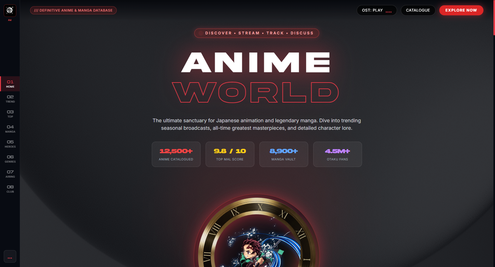
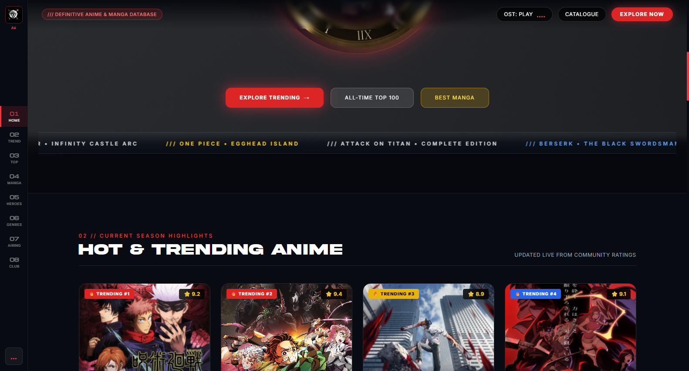
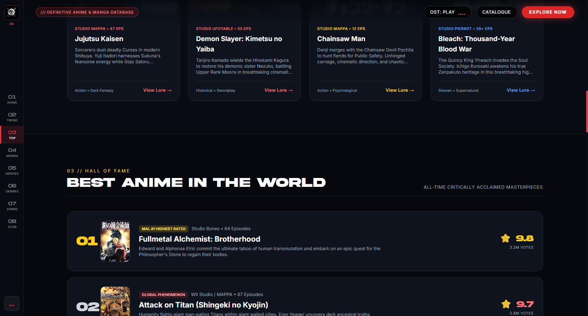

# Anime-world

<p align="center">
  
  
  
  
  
</p>

An immersive, cinematic anime & manga discovery portal featuring trending anime rankings, 3D character showcases, legendary manga archives, weekly simulcast airing schedules, and ambient anime audio.

---

## 📸 Hero Preview

<p align="center">
  
</p>

## 🖼️ UI Snapshot Gallery

<p align="center">
  
  
</p>

---

## ✨ Features

- 🎬 **Trending & Top-Rated Anime** - Discover iconic anime titles with studio information, season ratings, and episode counts.
- ⚔️ **3D Character Spotlight** - Interactive character cards highlighting famous abilities, factions, and character lore.
- 📚 **Manga Masterpieces** - Curated library of legendary manga with author credits, synopsis cards, and status tags.
- 📅 **Weekly Airing Schedule** - Day-wise simulcast anime release calendar aligned with Japan Standard Time (JST).
- 🎧 **Atmospheric OST Player** - Integrated background anime music player complete with an animated sound equalizer.
- 🌌 **Futuristic Dark Aesthetic** - High-energy neon typography, custom Akira fonts, and smooth micro-animations.

---

## 🛠️ Tech Stack

- **Frontend**: HTML5, Tailwind CSS, Custom Modern CSS
- **Interactivity**: Vanilla JavaScript (ES6+), Audio Web Controls
- **Typography**: Michroma, Akira Expanded, Space Grotesk, Bebas Neue

---

## 🚀 Quick Start

### 1. Clone the repository
```bash
git clone https://github.com/soorajstudio/Anime-world.git
cd Anime-world
```

### 2. Run locally
```bash
# Using Python
python -m http.server 8080

# Or using Node
npx serve .
```

Open [http://localhost:8080](http://localhost:8080) in your browser.

---

## 📄 License

This project is licensed under the MIT License — see the [LICENSE](LICENSE) file for details.

Developed with ❤️ by [Sooraj Studio](https://github.com/soorajstudio).
