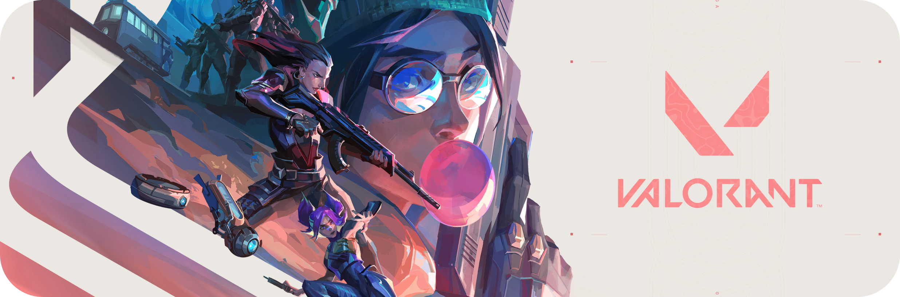

# ⚡ Anime World

> A modern, cinematic anime discovery experience crafted with passion.

## ✨ Features

- 🎬 **Cinematic Hero** — Immersive background, gradient glow effects, dynamic typography, and live statistics.
- ⚡ **Custom Cursor** — Glowing interactive cursor with smooth magnetic ring trailing.
- 🔄 **Infinite Anime Ticker** — Continuous animated marquee highlighting iconic series.
- 🔥 **Featured Spotlight** — Season spotlight showcasing top-tier anime with genre tags and quick actions.
- 📈 **Trending Rankings** — Real-time styled rankings with poster previews, ratings, and smooth transitions.
- 🃏 **Popular Series Grid** — Interactive cards with poster zoom, hover play buttons, episode tags, and rating badges.
- ⚔️ **Iconic Characters Showcase** — Visual character cards featuring fan favorites (Tanjiro, Goku, Naruto, Luffy, etc.).
- 🎭 **Genre Explorer** — Quick genre discovery pills with custom emojis and active catalogue counts.
- 📱 **Fully Responsive** — Optimized across mobile, tablet, laptop, and ultra-wide displays.
- 🚀 **Zero Dependencies** — Fast, self-contained HTML/CSS/JavaScript with smooth performance.

## 🛠️ Tech Stack

- **HTML5 & CSS3** (Vanilla, optimized, modern layout techniques: CSS Grid & Flexbox)
- **JavaScript** (ES6+, Intersection Observer API, smooth cursor animation)
- **Typography** — Google Fonts (Bebas Neue & Inter)

## 🚀 Getting Started

Simply clone the repository and open index.html in any modern web browser:

\\\ash
git clone https://github.com/soorajstudio/Anime-world.git
cd Anime-world
# Open index.html in your browser
\\\

---

Made with ❤️ by [Sooraj Studio](https://github.com/soorajstudio)
